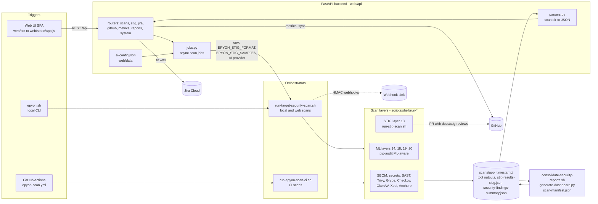
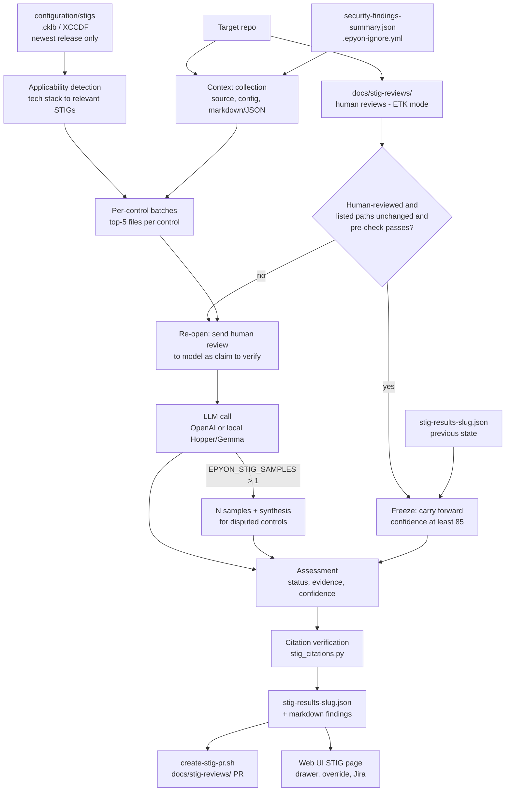
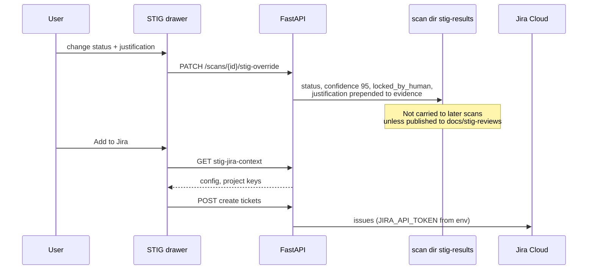

# Epyon — System Diagram (as of 3.78.x)

Mermaid diagrams; GitHub and VS Code render them. See `SYSTEM_ARCHITECTURE.md` for prose detail.

## 1. Components and data flow

## 2. STIG assessment pipeline (layer 13)

## 3. STIG override and Jira (current behaviour)

## Key facts

- One application = one repo = the unit of scans and STIG results. There is no Project entity yet (see `docs/FUTURE_IMPROVEMENTS.md` item 14).
- Persistent volumes on deployment: `./web/data`, `./configuration`, `./scans`.
- `EPYON_STIG_FORMAT`: web scans default to `etk`; CLI/CI default to `legacy`.
- Secrets (`JIRA_API_TOKEN`, `GITHUB_TOKEN`, `OPENAI_API_KEY`, `NVD_API_KEY`) are environment-only.
